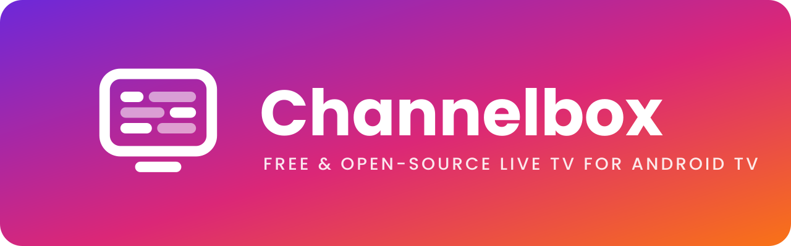

<div align="center">



**A free, open-source live TV player for Android TV – built to feel like a cable box.**

Turn on the TV, and you're watching TV. Channel up/down, a real programme guide, recordings.
Bring your own IPTV subscription (M3U or Xtream Codes).

[](https://github.com/Axon07/Channelbox/actions/workflows/build.yml)
[](https://github.com/Axon07/Channelbox/releases)
[](LICENSE)


**Downloader code: `5502923`** · [Download](#download) · [Features](#features) · [Remote control](#remote-control) · [Cable-box setup](#making-it-act-like-a-cable-box) · [Building](#building)

</div>

> [!NOTE]
> Channelbox is **only a player**. It doesn't include, sell or link to any channels. You need your own IPTV service.
> Not affiliated with any IPTV provider.

## Why

Paid IPTV players work well, but the good ones are closed source and subscription-based. Channelbox aims to be a
free alternative that's simple enough for anyone – especially people who just want their TV to behave like the cable
box they're used to.

## Download

Grab the latest `channelbox.apk` from **[Releases](https://github.com/Axon07/Channelbox/releases)**, or the
newest test build from the **[Actions](https://github.com/Axon07/Channelbox/actions)** tab (*channelbox-apks* artifact).

**Fire TV / Android TV:** open the **Downloader** app and enter code **`5502923`** – it always gets the latest version.
You can also use a USB stick, or `adb install channelbox.apk`.
The latest version is always at `https://github.com/Axon07/Channelbox/releases/latest/download/channelbox.apk`.

**Updates:** Channelbox checks for a new release when it starts and offers to install it (turn that off in Settings).
You can also use **Settings → Check for updates**. The first time, Android asks you to allow Channelbox to install apps.

## Features

| | |
|---|---|
| **Sources** | M3U / M3U8 playlist URL (incl. `.gz`), Xtream Codes login. **Several playlists at once**, merged into one lineup, each with its own name, guide and on/off switch. Huge provider lists (100 MB+) are read as they download |
| **Add from your phone** | The add-playlist screen shows a QR code: scan it, type the link or login on your phone, press Send. Works only on your home network and only while that screen is open |
| **TV guide** | XMLTV (incl. `.xml.gz`) from every guide the playlist lists (`url-tvg`), from Xtream, plus your own URLs. Channels are matched by `tvg-id`, then a loose id match, then by name (ignoring "US:", "HD", "(1080p)" and similar) |
| **Guide screen** | Cable-style grid (channels × time) with a live video preview in the corner, programme details and a "now" line. Marks programmes set to record and locked channels; adapts to small screens |
| **Groups menu** | Back from the guide: channel groups (one section per playlist when you have several), with shortcuts to Search, Movies, TV Shows, Recordings and Settings |
| **Movies & TV Shows** | From the playlist or the provider's Xtream API: poster grid by category, search, "Continue watching", seasons and episodes, resume where you stopped. Xtream-style M3U links get real posters and details from the API automatically |
| **Pause live TV** | Play/Pause while watching: the channel is buffered on the box from that moment (up to 2 hours); resume behind live, ⏩ to jump back to live |
| **Guide search** | Search programme titles across the whole guide; watch what's on, catch up on what aired, record what's coming |
| **Your lineup** | Rename, renumber, hide or lock channels; rename, reorder, hide or lock groups (hold OK). Survives playlist reloads; undo from Settings |
| **Parental PIN** | Lock channels, groups and movie/show categories, optionally Settings too. Zapping skips locked channels |
| **Playback** | Media3/ExoPlayer: HLS, MPEG-TS, DASH (`.mpd`, also `.mpd/…` links), Smooth Streaming, RTSP, RTMP and UDP multicast (`udp://@239.…`). Unknown links are tried as TS → HLS → DASH. A broken channel shows a message and retries – it never crashes the app |
| **Stream options** | Kodi-style `url|User-Agent=…&Referer=…`, `#EXTVLCOPT:http-user-agent/http-referrer`, `#EXTHTTP:{…}`, `#KODIPROP:inputstream.adaptive.stream_headers` |
| **DRM** | `#KODIPROP` `license_type`/`license_key`, `drm_legacy` and `drm` (JSON). ClearKey with keys in the playlist (`kid:key`, JSON, or key only) – also on streams whose manifest only lists PlayReady/Widevine. Widevine and PlayReady license servers with headers (`url|Header=Value|…`); PlayReady falls back to Widevine on boxes without it, and Widevine retries at security level L3 when L1 fails |
| **Catch-up / archive** | Watch programmes that already aired, straight from the guide (↺). M3U `catchup` = `default` / `append` / `shift` / `flussonic` / `xc` with `catchup-source` templates (`${start}`, `{utc}`, `{duration:60}`, `{Y}-{m}-{d}` …), and Xtream Codes archives (server time zone aware). Also "watch from the start" for shows that are on now |
| **Audio, quality & subtitles** | CC turns captions on and off. The ⋯ menu (or hold OK / Menu) picks subtitles, audio track, quality and picture size (fit, zoom, stretch). Optional maximum quality for slow connections |
| **Audio formats** | Bundled FFmpeg decoder plays Dolby Digital (AC3), Dolby Digital+ (E-AC3), DTS and TrueHD on boxes that can't – no more silent sports channels. Optional "decode all audio in software" setting |
| **Network & VPN** | Built-in **WireGuard VPN** (paste or load a config from any VPN provider; only Channelbox or the whole box), **HTTP / SOCKS5 proxy**, **encrypted DNS** (DNS-over-HTTPS: Cloudflare, Google, Quad9, AdGuard or custom) and a **user agent** setting – for privacy and for networks that interfere with streaming |
| **Multi-view** | Watch up to 4 channels at once (green button, ⋯ menu → Multi-view, or the on-screen button). The layout adapts to 2, 3 or 4 tiles; add more with Menu. Hold OK / long-press a tile for full screen, change or remove. Sound follows the highlighted tile |
| **Mini player** | Picture-in-picture when you press Home (optional) or from the on-screen buttons |
| **Stream info** | The info banner shows resolution, frame rate, codec, audio format, bitrate, available caption languages and VPN status |
| **Recording** | Record what's on now (● / red button) or schedule a programme from the guide. TS, HLS (incl. AES-128) and DASH. Save to this box, a USB drive / SD card, a network share (SMB) or WebDAV. DRM channels are saved exactly as delivered – still encrypted – and play back through the same licence as live TV |
| **Player controls** | Movies, episodes, recordings and catch-up: seek bar, elapsed/remaining time, ⏪ 10 s / ⏯ / ⏩ 30 s, CC and the ⋯ menu; tap the bar to jump |
| **Zapping** | Channel ▲/▼, number entry, previous channel, now/next info banner with a progress bar |
| **Channel list** | Press OK while watching: channels by group with what's on now |
| **Favourites** | Hold OK on a channel in the list or guide |
| **Set-top box mode** | Optional start on boot, optional "use as home screen", resumes the last channel. Back goes TV → Guide → Groups → "Exit?"; the last step can also be set to never exit, or exit straight away |
| **Touch & mouse** | Tap the picture for the controls (record, pause, live, favourite, CC, multi-view, mini player, ⋯); swipe up/down to change channel; tap anything in the list or guide |
| **Background refresh** | Playlist and guide reload every 6/12/24/48 hours, or only when you choose |

## Remote control

| Button | Watching TV | Channel list | Guide |
|---|---|---|---|
| ▲ / ▼, CH+ / CH− | Change channel | Move | Move (CH± = page) |
| ◀ | Open channel list | Previous group | Earlier |
| ▶ / Info | Show/hide info banner | Next group | Later |
| OK | Open channel list | Watch | On now: watch · finished: catch-up · future: record menu |
| Hold OK | ⋯ menu: audio, subtitles, quality, picture size | ★ favourite | Programme menu (watch / from start / record / favourite) |
| ● Record / red | Record what's on (again = stop) | – | Record / cancel the selected show |
| 0–9 | Go to channel number | Go to channel number | Jump to channel |
| Guide | Open guide | Open guide | Back to TV |
| Menu | ⋯ menu | Open guide | Groups menu |
| Back | Open guide | Close | Groups menu → Back again: "Exit?" |
| Last / Recall | Previous channel | Previous channel | – |
| CC / Subtitles | Captions on/off | – | – |
| Green | Multi-view | – | – |
| ⏯ Play/Pause | Pause live TV / resume | – | – |
| ⏩ / ■ Stop | Back to live (after a pause) | – | – |
| Search | Search the guide | – | Search the guide |

**Groups menu:** ▲▼ choose, OK select, ▶ or Back to the guide, hold OK on a group to rename / move / hide / lock it.
Search, Movies, TV Shows, Recordings and Settings are in the shortcut bar.
**Guide:** hold OK on a programme → *Edit channel…* to rename, renumber, hide or lock the channel.
**Playing a movie, episode, recording or catch-up:** OK / ⏯ pause, ◀ ▶ (or ⏪ ⏩) skip 10 s back / 30 s ahead,
CC for captions, hold OK for the ⋯ menu, Back hides the controls and then returns to the list.

### Where recordings are saved

By default `Android/data/io.github.axon07.channelbox/files/recordings/` on the box (`.ts`, `.mp4` for fMP4 HLS, or a folder with `manifest.mpd` for DASH). Change it in **Settings → Recordings**. Recordings on the box are removed if the app is uninstalled. DASH recordings stay on the box or USB / SD card. Scheduled recordings only happen if the box is on; a box in deep sleep may start late.

### Touch screen / mouse

Tap the picture to show the controls. Swipe up for the next channel, down for the previous one. In the channel list and guide, tap to watch and press-and-hold for more. In the guide, swipe sideways to move through time, tap the clock to jump back to now, and tap the small video to go back to full screen.

## Building

Requires Android Studio (Ladybug or newer) or JDK 17 plus the Android SDK.

```bash
git clone https://github.com/Axon07/Channelbox.git
cd Channelbox
./gradlew assembleDebug        # app/build/outputs/apk/debug/app-debug.apk
./gradlew testDebugUnitTest    # parser tests
```

Every push also builds APKs on GitHub Actions (see the *Actions* tab → *channelbox-apks* artifact).

### Installing on a TV box

```bash
adb connect <box-ip>:5555
adb install -r app/build/outputs/apk/debug/app-debug.apk
```

Or upload the APK somewhere and use the *Downloader* app on the box.

## Releasing

Releases are built by GitHub Actions and signed with a permanent key, so the in-app updater can install each new
version over the old one. One-time setup (Windows PowerShell, JDK 17 installed):

```powershell
$env:JAVA_HOME = (Get-ChildItem "C:\Program Files\Eclipse Adoptium" -Directory -Filter "jdk-17*" | Select-Object -First 1).FullName
& "$env:JAVA_HOME\bin\keytool.exe" -genkeypair -v -keystore "$env:USERPROFILE\channelbox-release.jks" -alias channelbox -keyalg RSA -keysize 4096 -validity 36500 -dname "CN=Channelbox"
[Convert]::ToBase64String([IO.File]::ReadAllBytes("$env:USERPROFILE\channelbox-release.jks")) | Set-Clipboard
```

Then in the repo: **Settings → Secrets and variables → Actions → New repository secret**:

| Secret | Value |
|---|---|
| `SIGNING_KEYSTORE_BASE64` | paste (the keystore, copied to the clipboard by the last line) |
| `SIGNING_STORE_PASSWORD` | the password you typed for the keystore |
| `SIGNING_KEY_ALIAS` | `channelbox` |
| `SIGNING_KEY_PASSWORD` | the same password |

Keep a backup of `channelbox-release.jks` and its password somewhere safe – if it's lost, existing installs can't be
updated and everyone has to uninstall and reinstall.

To release: **Releases → Draft a new release → new tag (e.g. `v1.0.0`) → Publish**. The workflow sets the app version from the
tag, builds the signed APK and attaches it; installed apps will offer the update.

## Making it act like a cable box

1. **Settings → Start when the box turns on** (off by default).
   Also consider **Settings → Back button while watching TV → Open the guide (never exit)** so nobody exits by accident.
2. On Android 10 and newer, Android only lets an app open itself after boot if it has the *Display over other apps* permission. Use **Settings → Permission for start on boot**. Some TV firmware hides that screen; grant it over adb instead:
   ```bash
   adb shell appops set io.github.axon07.channelbox SYSTEM_ALERT_WINDOW allow
   ```
3. Optional: **Settings → Use as home screen**, then press Home and choose Channelbox → *Always*. The box then boots, and Home returns, straight into live TV.
   Google TV (Chromecast with Google TV, newer Onn/Walmart boxes) ignores third-party home screens unless the stock launcher is disabled over adb. That step is at your own risk:
   ```bash
   adb shell pm disable-user --user 0 com.google.android.apps.tv.launcherx
   ```
   Undo with `pm enable`.

## Project layout

```
app/src/main/java/io/github/axon07/channelbox/
├── App.kt                 dependency container
├── MainActivity.kt
├── data/                  M3U, Xtream, XMLTV parsers, movies & shows, recorder, Room DB, settings
├── player/                ExoPlayer wrapper (auto-reconnect, DRM), pause-live-TV buffer
├── system/                boot receiver, background refresh, recording worker, phone link, home-screen helpers
└── ui/                    Compose for TV screens: player overlays, guide, settings, setup
```

Stack: Kotlin, Jetpack Compose for TV, Media3 ExoPlayer, Room, DataStore, WorkManager, OkHttp, Coil, ZXing. Min SDK 21 (Android 5.0).

## Roadmap

- [ ] Series recording (every episode of a show)
- [ ] Play the next episode automatically
- [ ] Optional TMDB artwork for providers that send poor pictures
- [ ] Translations

## License

[GPL-3.0](LICENSE). You can use, change and share Channelbox freely, but anything you distribute that's built from it must stay open source under the same license.
